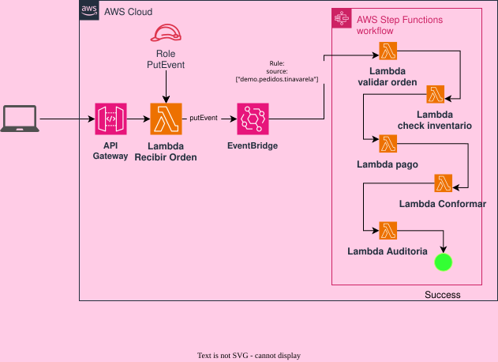
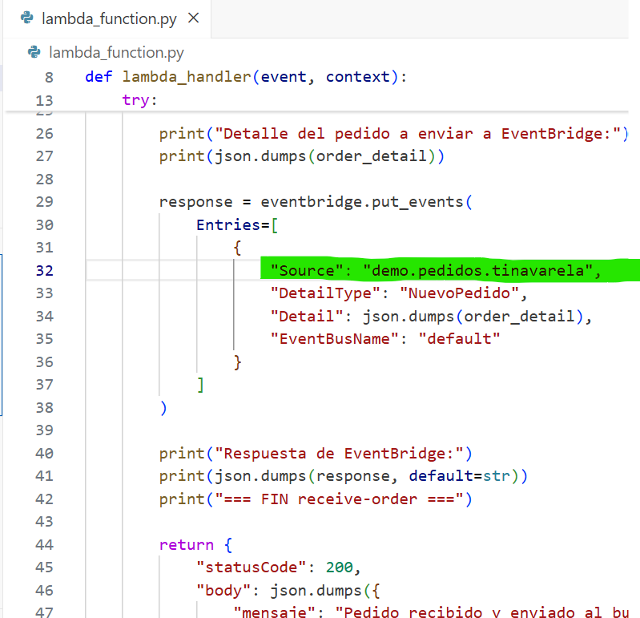
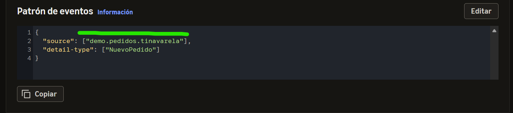
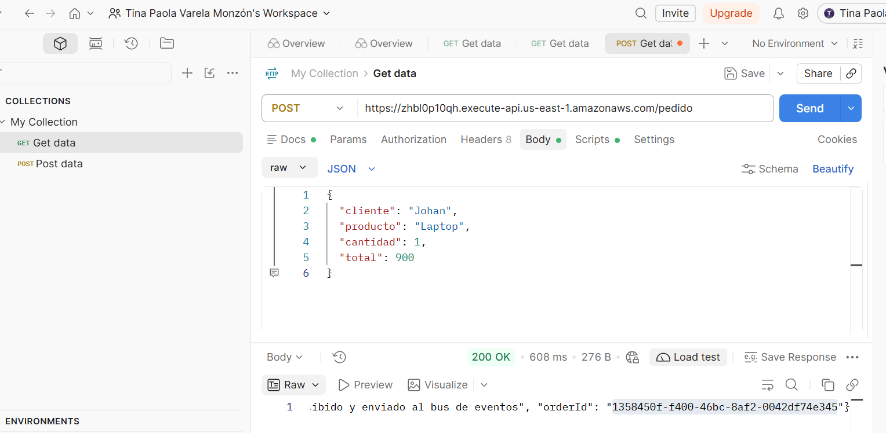
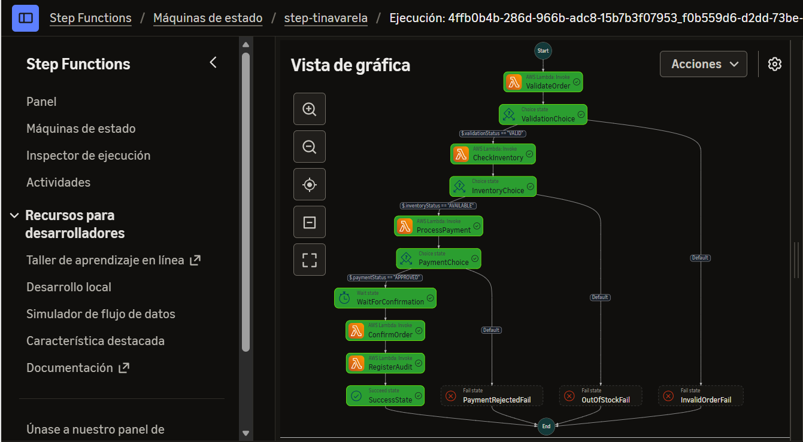

<div align="center">

#  Laboratorio: Automatización de solicitudes con API Gateway
### Orquestación Asíncrona con Amazon EventBridge y AWS Step Functions


<p align="center">
  <b>Objetivo:</b> Configurar una arquitectura orientada a eventos utilizando Amazon API Gateway, AWS Lambda, Amazon EventBridge y AWS Step Functions, resolviendo la colisión de eventos en un entorno de cuenta compartida mediante la personalización del patrón de enrutamiento.
</p>

</div>

---

---
##  Diseño de Arquitectura

A continuación, se presenta el diagrama de arquitectura diseñado para esta solución, el cual ilustra el flujo de eventos desde la petición HTTP inicial hasta el procesamiento asíncrono en la máquina de estados, destacando el aislamiento del entorno.

<div align="center">
  
  <br>
  <sub><b>Figura 1.</b> Flujo desacoplado de extremo a extremo: Ingesta HTTP, enrutamiento por patrón de origen (<code>demo.pedidos.tinavarela</code>) y máquina de estados.</sub>
</div>

---
## 🛠️ Especificaciones Técnicas y Rol de Componentes

| Servicio / Tecnología | Rol en la Arquitectura | Justificación Técnica |
| :--- | :--- | :--- |
| **Amazon API Gateway** | Puerta de enlace HTTP | Expone el endpoint `POST` público y desacopla al cliente de la lógica interna. |
| **AWS Lambda (Python)** | Productor de eventos y tareas | Procesa el payload inicial, inyecta el atributo `Source` y ejecuta cada paso de negocio sin aprovisionar servidores. |
| **Amazon EventBridge** | Bus de eventos y enrutador | Filtra eventos en tiempo real mediante la regla `source: ["demo.pedidos.tinavarela"]`, evitando colisiones en la cuenta compartida. |
| **AWS Step Functions** | Orquestador de flujo (Workflow) | Coordina la secuencia (Validar ➔ Inventario ➔ Pago ➔ Confirmar ➔ Auditoría) con manejo visual de estados. |
| **AWS IAM** | Seguridad y Gobernanza | Aplica el principio de mínimo privilegio mediante el rol específico `PutEvents` en el bus de eventos. |

<details>
  <summary><b>🔍 Ver estructura del Payload JSON y Evento de Prueba (Click para desplegar)</b></summary>
  <br>

**1. Petición enviada desde Postman (`POST`):**
```json
{
  "cliente": "Johan",
  "producto": "Laptop",
  "cantidad": 1,
  "total": 900
}
```

**2. Evento aislado inyectado en Amazon EventBridge:**
```json
{
  "Source": "demo.pedidos.tinavarela",
  "DetailType": "NuevoPedido",
  "EventBusName": "default"
}
```
</details>

---
---

## 1. Actualización de la Función Lambda (Aislamiento de Eventos)
En esta captura se evidencia la modificación del código fuente de la función Lambda inicial (`receive-order-tinavarela`). Para resolver el problema de colisión de eventos en el entorno compartido de AWS, se personalizó el atributo `Source` dentro del método `put_events`. Al asignar el valor unívoco `"demo.pedidos.tinavarela"`, se garantiza que el evento publicado en el bus posea una firma de origen exclusiva, estableciendo el primer paso para una arquitectura completamente aislada.



---

## 2. Configuración del Patrón de Enrutamiento en Amazon EventBridge
La imagen detalla la actualización de la regla de enrutamiento dentro de Amazon EventBridge. El patrón de eventos (*Event pattern*) fue ajustado estrictamente para filtrar y capturar únicamente los eventos cuyo origen coincida con `"demo.pedidos.tinavarela"`. Esta configuración crea un canal de comunicación directo y exclusivo entre la Lambda inicial y la máquina de estados, evitando que la ejecución se vea alterada por peticiones generadas por otros usuarios en la misma cuenta de AWS.



---

## 3. Invocación del API Gateway y Validación del Cliente (Postman)
Se presenta la prueba de integración final (End-to-End) desde el cliente HTTP Postman. Se inyectó un *payload* de prueba en formato JSON simulando los datos de un cliente mediante una petición POST dirigida al Amazon API Gateway. La recepción de un código de estado HTTP `200 OK`, acompañado de un mensaje de confirmación y un `orderId` generado, certifica que la petición fue procesada correctamente por el API y delegada con éxito a la función Lambda para su transmisión al bus de eventos.



---

## 4. Trazabilidad y Culminación Exitosa en AWS Step Functions
Esta evidencia final ilustra el diagrama de flujo de la máquina de estados (`step-tinavarela`) correspondiente a la ejecución del pedido aislado. La iluminación en verde de todos los nodos del flujo (tales como *ValidateOrder*, *CheckInventory* y *ProcessPayment*) hasta llegar al *SuccessState*, demuestra que el sistema procesó la lógica de negocio sin interrupciones ni desvíos hacia los estados de fallo. Esto comprueba el éxito absoluto de la implementación de la arquitectura *serverless*, logrando un flujo de eventos asíncrono, robusto y correctamente segmentado.




---
<div align="center">
  <sub>Desarrollado y documentado por <b>Tina Varela</b> — Cloud Architecture & Software Development</sub>
  <br><br>
  <a href="https://github.com/tinapavare">
    
  </a>
</div>
